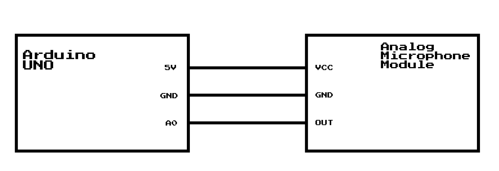
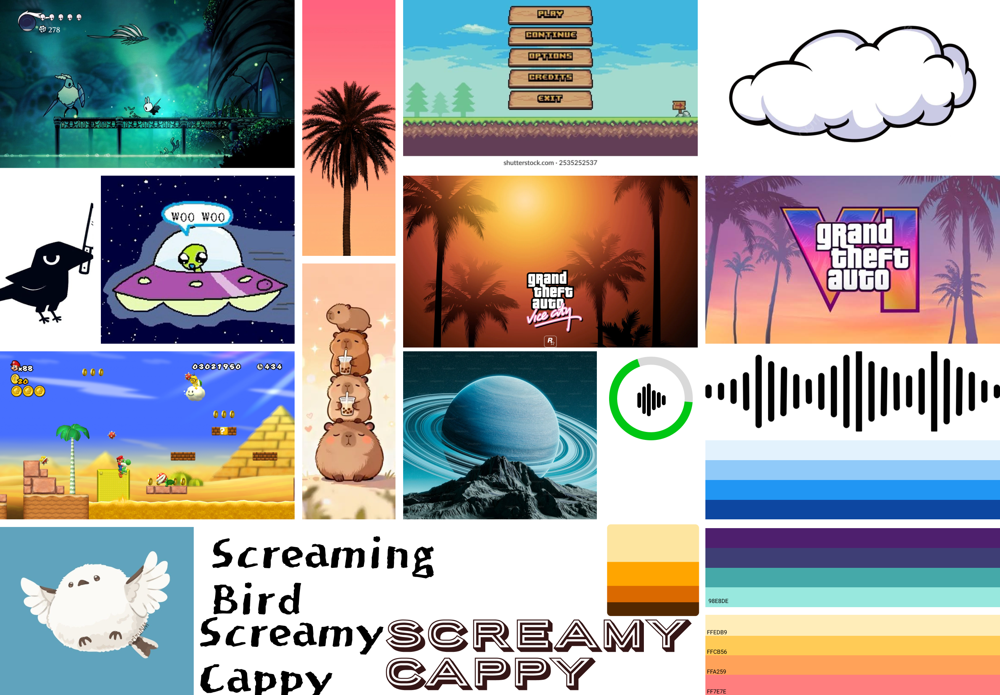
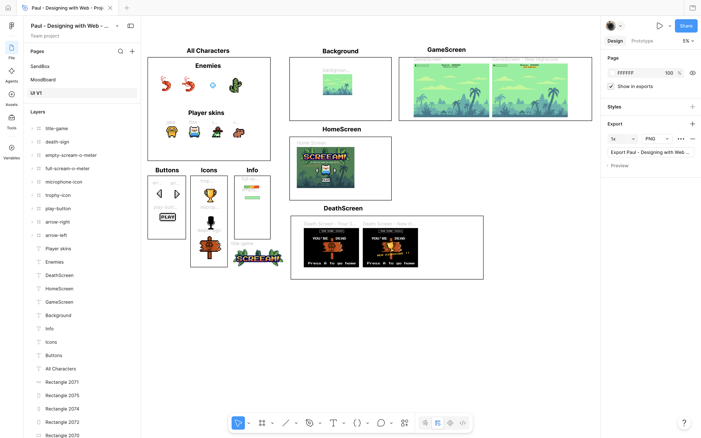

# Paul's SCREEAM game

Voici la table des matières de mon rendu
- [Code of the electronic part↗](cwiot/project.ino)
- [schematic view](#schematic-view)
- [Moodboard](#moodboard)
- [UI on figma](#figma-ui)
- [Code of the web part↗](dww/index.html)
- [Video](#video)

## schematic view
<picture>
    
</picture>

This prototype uses an Arduino UNO board, along with an analog microphone module. It also includes 3 male-female jumpers

## Moodboard

<picture>
  

The moodboard reflects what my game was initially supposed to be. The game was supposed to be a game where the louder you scream, the higher the character goes, which is currently the case. Nonetheless, I wanted to add the fact that if you scream loud enough, you can reach other levels, notably a sky level where the character jumps on clouds, and even a space level. That's why you'll find clouds, and aliens in the moodboard. 
</picture>

## Figma UI

Here's the link of my figma [figma UI↗](https://www.figma.com/design/tstgXu5zfpl18AcXzv6c6y/Paul---Designing-with-Web---Project?node-id=9-5&t=pJkxpUcS3BvtpxCE-1)`

## Web part
Here is a preview of the assignment. finalement c dns la video 

what is it: 

## Video

[See the video on youtube↗](https://youtu.be/7-YfWs-cX3M)